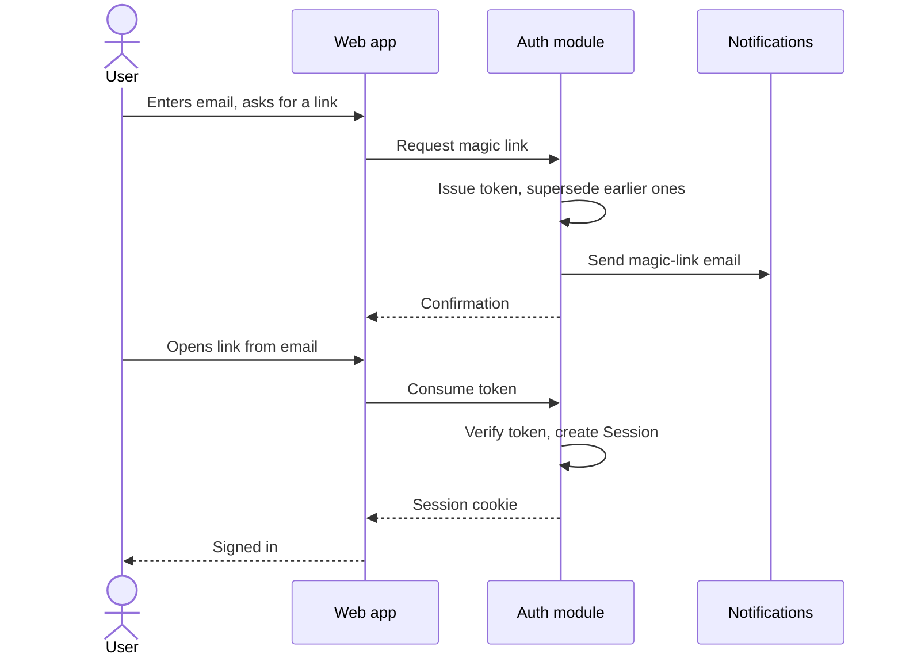
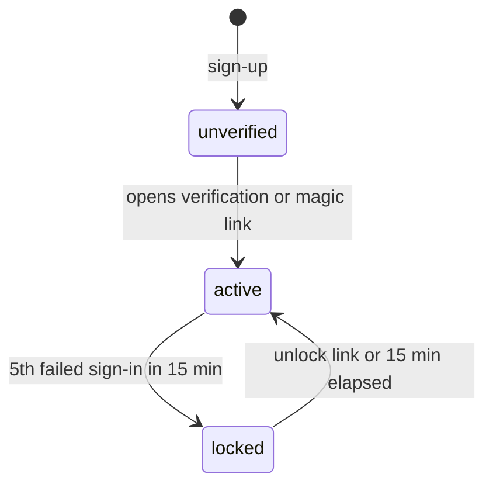

# Example spec

`docs/specs/authentication.md` for a team collaboration app.

````md
# Authentication

Authentication establishes who a **User** is and keeps them signed in across devices. It covers sign-up, sign-in with a password or a magic link, sessions, and password recovery. Each area defines its own permissions on top of the authenticated User this spec provides (see [Workspaces](workspaces.md)).

## Concepts

- A **User** is identified by their email address, which is unique and compared case-insensitively.
- A **Session** binds one device to one User. A User can hold many Sessions at once, one per device.
- A **Login token** is a single-use secret sent by email. It proves control of the address and serves four purposes: email verification, magic-link sign-in, password reset and account unlock.

## Behaviour

### Sign-up

A visitor signs up with an email and a password. A password is accepted when it has at least 12 characters and is absent from the breached-passwords list.

The account starts as `unverified` and a verification email is sent, carrying a link valid for 24 hours. An unverified User can sign in and has read-only access to their workspaces; opening the link moves the account to `active`.

Sign-up answers with the same confirmation page whether or not the email is already registered. When it is, the account owner receives an email saying someone tried to register with their address, with a link to password recovery.

### Sign-in with password

The User enters email and password. On success a new Session is created for the device.

Failed attempts are counted per email. The fifth failure within 15 minutes moves the account to `locked` for 15 minutes and sends the owner an email with an unlock link; opening it returns the account to `active` immediately. While locked, sign-in shows a message pointing to that email.

### Sign-in with magic link

From the sign-in screen the User can ask for a sign-in link by entering their email. The link:

- signs in the device where it is opened, whichever device requested it;
- is valid for 15 minutes and works once;
- supersedes every earlier magic link for the same User.

Opening a magic link also verifies the email of an `unverified` account. An expired, used or superseded link opens a page explaining what happened, with a button to send a new link.

Link requests are limited to 3 per email every 15 minutes and 20 per IP address every hour. The request always answers with the same confirmation, whether or not the email is registered.



### Sessions

A Session lasts 30 days from its last activity; every authenticated request extends it.

The account page lists the User's active Sessions with device name, approximate location and last activity. From there the User can end any single Session or all of them at once. Changing the password ends every Session except the current one.

### Password recovery

The User requests a reset link by entering their email; the request always answers with the same confirmation. The link is valid for 1 hour and works once. Setting a new password ends every Session of the User and signs in the current device.



## Architecture

The auth module inside the API server owns Users' credentials, Sessions and Login tokens. Every other module receives the authenticated User from the request context and reads identity through the auth module's interface.

Sessions are stored server-side in the primary database. The browser holds only an opaque Session ID in an `HttpOnly`, `Secure`, `SameSite=Lax` cookie.

Emails are delivered by the Notifications service, which the auth module calls with a template name and its parameters.

Passwords are checked against the Have I Been Pwned range API, sending only the first five characters of the password's SHA-1 hash. When the service is unreachable, sign-up proceeds with the length check alone and logs a warning.

## Data model

- **User**: email, password hash, status (`unverified`, `active`, `locked`), verified at, locked until.
- **Session**: User, created at, last active at, expires at, device name, approximate location.
- **Login token**: User, purpose, token hash, expires at, used at, superseded at.

## Non-functional requirements

- Passwords are hashed with argon2id, with parameters tuned to about 250 ms per hash on production hardware.
- Login tokens carry 256 bits of randomness and are stored as SHA-256 hashes.
- Sign-in answers within 500 ms at the 95th percentile, hashing included.
- Every authentication event (sign-up, sign-in, failure, lockout, password change, Session ended) is written to the audit log and retained for one year.

## Decisions

- **Server-side Sessions instead of JWTs.** Sessions must end immediately on "sign out everywhere" and on password change. With stateless tokens that requires a revocation list checked on every request, which brings back the database lookup JWTs were meant to avoid, plus a second mechanism to keep consistent.
- **Uniform answers on sign-up, magic-link and recovery requests.** Identical answers keep registered addresses private; the account owner is told by email instead.
- **Magic links next to passwords.** Password recovery was the most common reason for sign-in support tickets. Magic links give infrequent users a password-free path, while passwords remain for users who prefer them and for password managers.

## Related specs

- [Workspaces](workspaces.md): roles and permissions built on the authenticated User.
- [Notifications](notifications.md): delivery of every authentication email.
- [Audit log](audit-log.md): storage and retention of authentication events.
````
